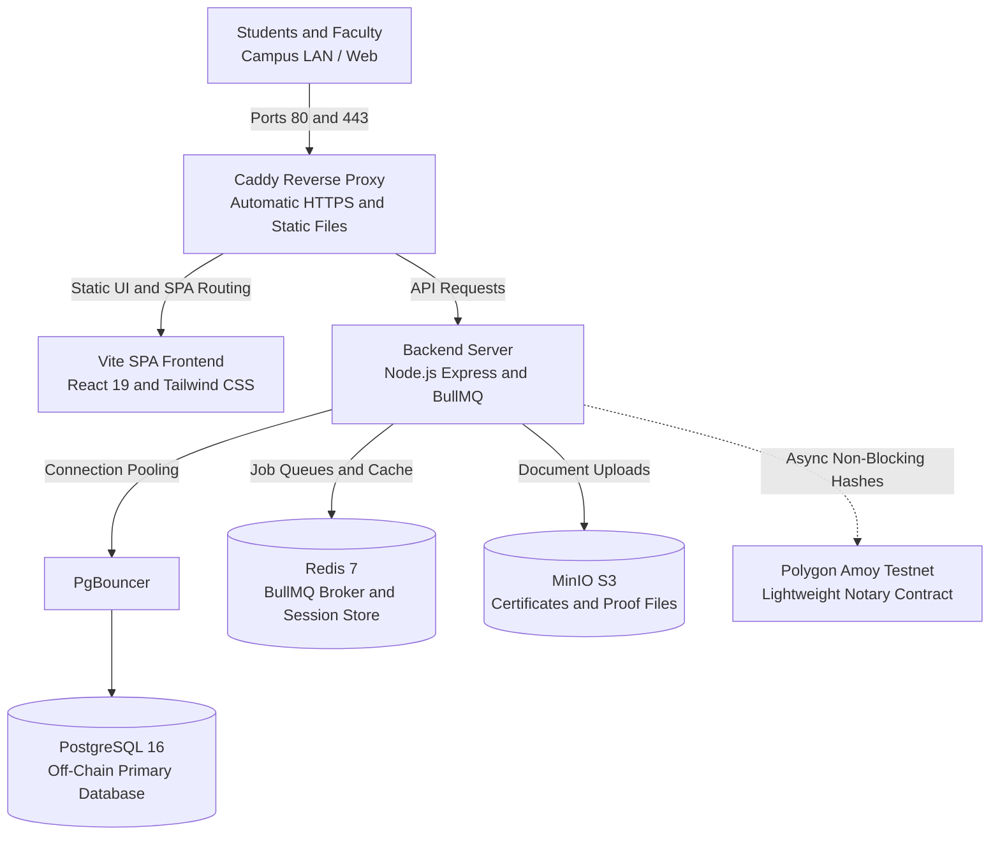

<div align="center">

# Cryptid

**The operating system for college cybersecurity departments.**  
*Skill is earned. Effort is visible. No spreadsheets, no arbitrary grading.*

<p align="center">
  <a href="cryptid_intro.mp4">
    
  </a>
</p>
<p align="center">
  <a href="cryptid_intro.mp4">Watch the full 1080p 60fps video with sound (16s)</a>
</p>

[](https://nodejs.org/)
[](https://react.dev/)
[](https://www.typescriptlang.org/)
[](https://www.postgresql.org/)
[](https://polygon.technology/)
[](https://www.docker.com/)

[**Features**](#what-cryptid-does) • [**The 4 Houses**](#the-4-houses) • [**Architecture**](#architecture) • [**Quickstart**](#quickstart) • [**Deployment**](DEPLOYMENT.md)

</div>

---

## Why We Built This

In most college departments, recognition comes down to attendance sheets, email chains, and spreadsheets that tell recruiters nothing about actual technical competence. Meanwhile, students spend hundreds of hours solving CTFs, pwning boxes on HackTheBox, grinding competitive programming, and writing open-source security tools in total silence.

**Cryptid turns real effort into undeniable proof of work.**

It organizes the department into four specialization houses, syncs real-world student profiles across external security platforms, maintains a transparent points ledger, lets students trade points for tangible department perks (like academic On-Duty passes and CTF team seats), and gives students an untraceable, anonymous channel to report issues without fear.

It is built specifically for college resources: modest infrastructure, closed student/faculty networks, and clean, auditable oversight without startup bloat.

---

## What Cryptid Does

### 1. Proof-of-Work Student Profiles
Every student receives a personal dossier showing their verified technical footprint:
- **Live Sync:** Direct stat synchronization from HackTheBox, Codeforces, and GitHub.
- **Verified Submissions:** CTF writeups, certifications, and research papers uploaded for fast teacher review.
- **Seasonal Ledger:** All earned points are logged with a clear rationale. Points reset each term so newcomers aren't trapped behind graduating seniors.

### 2. Inter-House Leaderboards
Students compete individually and as part of their assigned house. Leaderboards update in real-time, driving departmental rivalries across offensive, defensive, infrastructure, and threat intel tracks.

### 3. Real Perks & Bounties
Points aren't vanity numbers—students redeem them for things that actually matter:
- **Academic On-Duty (OD) Passes:** Excused attendance for approved CTF competitions or conferences.
- **Team Slots:** Priority access to university CTF teams and specialized workshop seats.
- **Referrals & Hardware:** Direct placement recommendations and department lab access.

### 4. Immutable Notary (Polygon Testnet)
To allow external recruiters and companies to independently verify high-value student credentials without trusting the college server:
- High-tier achievements generate a deterministic **SHA-256 hash**.
- The hash is committed asynchronously to a lightweight smart contract on the **Polygon Amoy testnet**.
- **Zero PII On-Chain:** Student identities, points, and grades never touch the blockchain—only cryptographic integrity hashes.

### 5. 100% Untraceable Grievances
A zero-knowledge reporting channel for grading disputes, house unfairness, or harassment.
- No student IDs, session tokens, or IP addresses are ever saved in the complaints database.
- Submissions return a random cryptographic **Tracking Key** so students can check status updates without logging in.

---

## The 4 Houses

Different skills. One community. A stronger tomorrow.

Every student is placed into a specialization house corresponding to their core technical domain, mascot, and operational focus.

| House | Identity | Mascot | Motto | Core Philosophy |
| :--- | :--- | :--- | :--- | :--- |
| **Red House** | The Offensive Force | Lion | "Find. Break. Improve." | We think like adversaries to make systems stronger. |
| **Blue House** | The Defensive Shield | Wolf | "Detect. Defend. Stay Ahead." | We build resilient systems and defend what matters. |
| **Green House** | The Innovation Engine | Phoenix | "Build. Research. Create." | We turn ideas into solutions for real-world impact. |
| **Purple House** | The Strategic Mind | Panther | "Analyse. Solve. Lead." | We connect people, processes and possibilities. |

### Red House: The Offensive Force
- **Motto:** "Find. Break. Improve."
- **Banner:** Offense today. A safer tomorrow.
- **Mascot:** Lion
- **Philosophy:** We think like adversaries to make systems stronger.
- **Key Skillsets:**
  - Cyber Fundamentals
  - Network Reconnaissance
  - Web & API Security
  - Vulnerability Assessment
  - Penetration Testing
  - Exploit Development
  - Red Team Operations
  - Active Directory Security
  - CTF & Competitive Hacking
  - Security Research

### Blue House: The Defensive Shield
- **Motto:** "Detect. Defend. Stay Ahead."
- **Banner:** Strong systems. Safer tomorrows.
- **Mascot:** Wolf
- **Philosophy:** We build resilient systems and defend what matters.
- **Key Skillsets:**
  - SOC Fundamentals
  - SIEM & Log Analysis
  - Threat Hunting
  - Incident Response
  - Digital Forensics (Intro)
  - EDR / XDR
  - Network Defence
  - Malware Analysis (Basic)
  - Cloud Security Monitoring
  - Security Operations
  - Risk & Resilience

### Green House: The Innovation Engine
- **Motto:** "Build. Research. Create."
- **Banner:** Ideas today. Impact tomorrow.
- **Mascot:** Phoenix
- **Philosophy:** We turn ideas into solutions for real-world impact.
- **Key Skillsets:**
  - Secure Coding & DevSecOps
  - Application Security
  - Cloud & Container Security
  - AI Security
  - IoT / Embedded Security
  - Cryptography
  - Research & Development
  - Emerging Technologies
  - Prototyping & Product Build
  - Open Source Contribution
  - Innovation & Entrepreneurship

### Purple House: The Strategic Mind
- **Motto:** "Analyse. Solve. Lead."
- **Banner:** Think beyond. Secure for all.
- **Mascot:** Panther
- **Philosophy:** We connect people, processes and possibilities.
- **Key Skillsets:**
  - Cyber Intelligence (OSINT)
  - Threat Intelligence
  - GRC & Policy
  - Risk Analysis
  - Privacy & Compliance
  - Cyber Law & Ethics
  - Business Continuity
  - Leadership & Communication
  - Project Management
  - Industry Collaboration
  - Strategy & Transformation

### Department Core Pillars
- **Skills for Life:** Developing technical fundamentals and applied engineering competence.
- **Competitions for Growth:** Testing capabilities under pressure in CTFs, hackathons, and war games.
- **Ideas for Impact:** Translating applied research and tools into tangible department impact.
- **Collaboration for Change:** Bridging offensive, defensive, infrastructure, and intelligence teams.
- **Leadership for Tomorrow:** Cultivating strategic minds capable of securing modern digital infrastructure.

---

## Architecture

Cryptid is built with a decoupled, high-throughput service topology designed to easily handle 500 to 10,000 students on modest college hardware:



- **Frontend:** React 19, TypeScript, Vite, Tailwind CSS, Lucide icons, motion graphics engine.
- **Backend:** Node.js, Express, Prisma ORM, BullMQ background queues.
- **Storage & Caching:** PostgreSQL 16 (with PgBouncer connection pooling), Redis 7, MinIO.
- **Blockchain Notary:** Lightweight Solidity contract deployed on Polygon Amoy.

---

## Quickstart

### Prerequisites
- Node.js 20+ and `npm`
- Docker & Docker Compose

### 1. Clone & Install
```bash
git clone https://github.com/Sreejesh06/Cryptid.git
cd Cryptid

# Install root, client, and server dependencies
npm install
cd client && npm install && cd ..
cd server && npm install && cd ..
```

### 2. Configure Environment
```bash
cp .env.example .env
```
Update your `.env` with your local PostgreSQL credentials, Redis port, and college domain validation rule (e.g. `@college.edu`).

### 3. Start Database & Infrastructure
```bash
docker compose up -d postgres redis minio
```

### 4. Run Migrations & Seed
```bash
cd server
npx prisma migrate dev
npx prisma db seed
cd ..
```

### 5. Start Development Servers
```bash
# In separate terminal windows or using npm run dev:
npm run dev
```
- **Web Client:** `http://localhost:5173`
- **API Server:** `http://localhost:3000`

---

## Production Deployment

For full bare-metal or campus VM deployment runbooks, zero-downtime updates, automated backups, and Caddy SSL configuration, see [**DEPLOYMENT.md**](DEPLOYMENT.md).

---

## License & Department Policy

Maintained by students and faculty of the Department of Cybersecurity.  
Distributed under the **MIT License**. Use freely for academic and departmental deployments.
